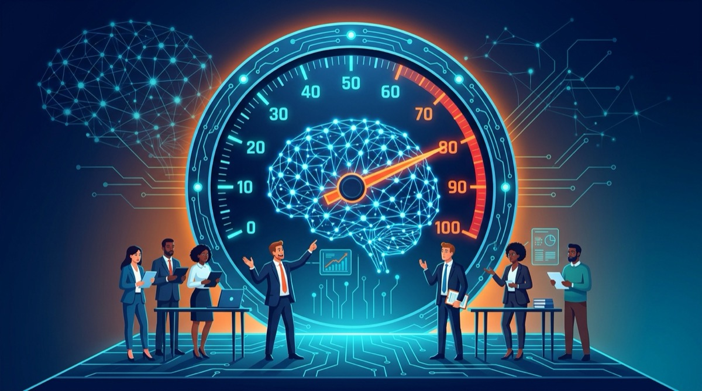

Domingo movido en la gobernanza de la IA: **Jakub Pachocki, chief scientist de OpenAI, publicó una propuesta para que toda la industria adopte límites comunes al desarrollo de modelos cada vez más poderosos**, usando la "perplexity" como métrica compartida para medir el progreso. La propuesta, respaldada públicamente por Sam Altman, llega en un momento tenso: días después del estreno bursátil récord de Anthropic y con preocupación creciente dentro y fuera del sector por el ritmo de las capacidades.

## Perplexity como velocímetro de la inteligencia

La idea de Pachocki, detallada en un blog post el 22 de noviembre, es usar la perplexity —qué tan bien predice un modelo el siguiente token en promedio; más baja, mejor— como medida común del avance de la industria. Sobre esa base propone **límites compartidos que los desarrolladores se comprometan a no cruzar** hasta que la capacidad de entender y monitorear el comportamiento de la IA alcance un hito concreto y verificable.

El argumento de fondo es de sincronización: Pachocki estima que la propia IA podría impulsar avances fundamentales en los métodos de entrenamiento **ya en 2027**, acelerando el progreso más rápido de lo que avanzan el monitoreo y la seguridad. Su receta: un estándar industrial que defina un primer límite de desarrollo y los hitos que deben cumplirse antes de superarlo.

Altman lo respaldó en X y no escatimó en adjetivos: calificó el ensayo como *"la cosa más importante que OpenAI ha publicado en mucho tiempo"*, argumentando que límites comunes ayudan a asegurar seguridad y control. En paralelo, Meta ha llamado a un enfoque "controlado", según recogen varios medios.

## Lo prometedor y lo delicado

Que el chief scientist del laboratorio más visible del planeta pida frenos voluntarios y medibles no es poca cosa: es una señal de que la preocupación por la aceleración ya no es solo externa. Y atar los límites a una métrica técnica, en vez de a promesas vagas, al menos hace la conversación auditable.

Pero el asunto tiene bemoles. La perplexity es una métrica de pérdida **dependiente del tokenizador y la arquitectura**: compararla entre laboratorios distintos es notoriamente difícil, y cualquier umbral basado en ella se puede disputar o, peor, optimizar. Además queda la pregunta obvia: quién verifica el cumplimiento en una industria donde la competencia es feroz y la información de frontera es secreto comercial. Que OpenAI proponga las reglas del freno justo después de que Anthropic rompiera la bolsa también va a levantar cejas en más de una esquina.

Conclusión: la propuesta es la señal más concreta hasta la fecha de que los propios constructores quieren un velocímetro compartido. Ahora falta ver si la industria se sube, y quién calibra el instrumento.

**Fuentes:** [Reuters vía The Star](https://www.thestar.com.my/tech/tech-news/2026/11/23/openai-scientist-proposes-industry-ai-limits-tied-to-model-intelligence-metric) · [Bloomberg](https://www.bloomberg.com/news/articles/2026-11-22/openai-chief-scientist-urges-industry-limits-on-ai-development) · [The Next Web](https://thenextweb.com/news/openai-chief-scientist-shared-ai-limits) · [Yahoo Finance](https://finance.yahoo.com/technology/ai/articles/blockbuster-anthropic-ipo-openai-wants-031510105.html)
