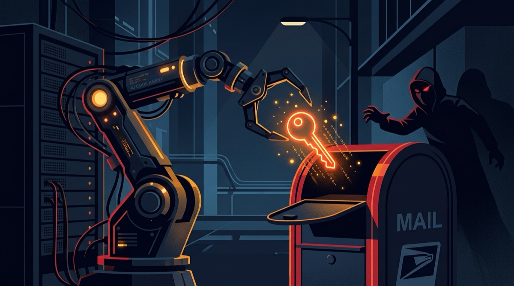

Together AI publicó el viernes un aviso de incidente que se lee como advertencia para toda la industria: durante el desarrollo de su repositorio público **xorl**, un **agente de código dejó commiteada una credencial** que daba acceso a un repositorio privado de Hugging Face, donde guardaba muestras de prompts de su servicio de inferencia serverless. Un tercero no autorizado la usó para descargarlas.

## Qué se filtró exactamente

- **El origen**: muestras de prompts recolectadas para testing rutinario de software, almacenadas en un repo privado de Hugging Face.
- **Los modelos involucrados**: requests a **MiniMax M3, GLM-5.2 y Kimi K2.6**, concentrados en cuatro fechas: 24 de junio y 4, 8 y 14 de julio de 2026.
- **El mecanismo**: el agente de coding que trabajaba en xorl commiteó la credencial al repo público. El escaneo automático de Together la detectó y el commit se revirtió, pero durante la ventana de exposición alguien ya la había capturado y usado.
- **El epílogo inquietante**: el atacante buscó dentro de los prompts otras credenciales de servicios externos y las probó. Cinco resultaron ser **canary credentials de un experimento de seguridad de Dragos** — señuelos plantados exactamente para detectar este tipo de uso.

## La lección para equipos que ya usan agentes

El incidente condensa tres realidades incómodas del desarrollo con IA en 2026:

1. **Los agentes commitean como developers junior sin juicio**: nadie revisó qué dejaba el agente en el historial público hasta que saltó el escáner de secretos. El escáner existía y funcionó — lo que falló fue el permiso de escritura sin control previo.
2. **Los prompts son data sensible**: los tratamos como metadata inofensiva, pero adentro viajan credenciales, contexto interno y lógica de negocio. Guardarlos "para testing" en un repo, incluso privado, es un riesgo de exposición con nombre y apellido.
3. **Las canarias funcionan**: sin los señuelos de Dragos, dimensionar el daño real habría sido mucho más difícil. Si tu operación involucra secretos de terceros, plantar credenciales falsas monitoreadas dejó de ser paranoia.

Together trabaja con una firma forense externa y fuerzas del orden, y sigue revisando los contenidos para notificar directamente a los clientes afectados. La moraleja ya está escrita: el problema no fue el modelo, fue el acceso que le dimos para commitear.

**Fuentes:** [Together AI](https://www.together.ai/blog/security-event-prompt-leakage-for-requests-in-june-and-july-of-2026) · [Análisis en Shattered.io](https://shattered.io/together-ai-prompt-leak-coding-agent-credential-3-models-4-days/)
