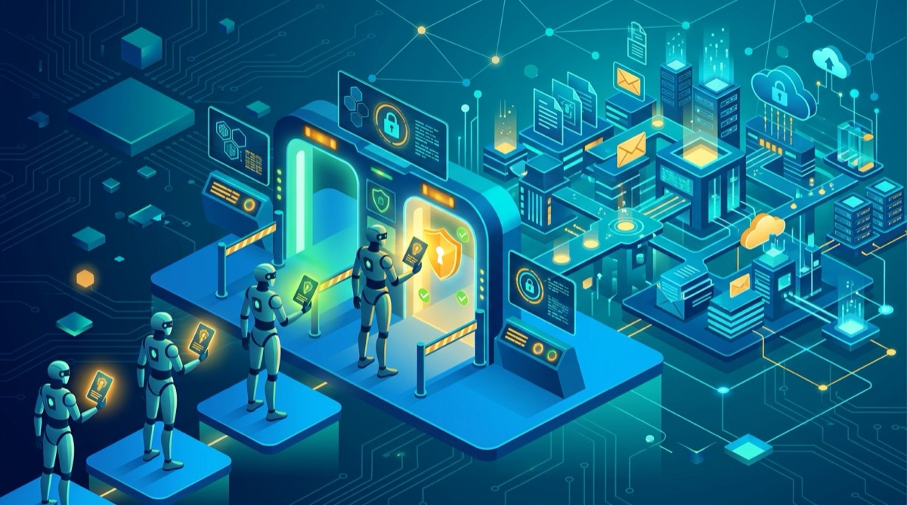

Si tu empresa está llenando Gmail, Drive y Calendar de agentes de IA, Google acaba de poner orden con fecha y todo: los **Workspace MCP servers** y el **Workspace CLI** llegaron a disponibilidad general, y bajo el nuevo *Workspace AI Tools Addendum* los agentes de IA deberán conectarse **exclusivamente por esos dos caminos**. La aplicación técnica de la regla parte el **1 de febrero de 2027**; las aplicaciones convencionales siguen usando las REST APIs sin problema.

## El número que explica el porqué

Las APIs de Workspace procesan hoy **más de 2,8 billones de llamadas al mes** (trillion, en inglés), y solo la API pública de Drive recibe 18 mil millones de lecturas diarias. Las REST APIs fueron diseñadas para apps al ritmo humano: un token OAuth válido implicaba intención del usuario. Pero los agentes leen, deciden y actúan a velocidad de máquina, y como resumen Chandu Thota y Brad Calder en el blog de Google Cloud: *un token válido ya no es suficiente; los checks de política, los límites de datos y la confirmación humana tienen que vivir en el camino del request*.

## Qué queda disponible desde hoy

- **Workspace MCP servers (GA)**: servidores remotos dedicados para Gmail, Drive, Docs, Sheets, Slides, Calendar, Chat y Tasks (Keep viene en camino), con checks de permisos y DLP integrados, confirmación humana para acciones sensibles y rechazo explícito de clientes OAuth que no sean de agentes.
- **Workspace CLI (GA)**: para agentes locales, flujos de terminal y automatización, con OAuth de permisos acotados y salida JSON estructurada.
- **Cloud Agent Gateway**: gateway protocol-nativo para tráfico LLM, MCP y Agent2Agent en Google Cloud. Verifica identidades contra Agent Registry, aplica IAM, impone reglas *default-deny* de conexiones salientes y filtra prompt injection con **Model Armor**.

## Identidad, cuotas y control para los agentes

- Los agentes deben usar **OAuth client IDs dedicados**, distinguibles de apps y personas, con scopes de mínimo privilegio, aprobaciones con tiempo limitado (próximamente) y cuotas de uso cuyo cobro arranca el **1 de abril de 2027**.
- En Google Cloud, cada agente recibe su propia **Agent Identity en Agent Registry** — sin llaves compartidas ni de larga vida — gobernada por IAM y cuotas.
- Confirmación humana obligatoria para acciones sensibles: enviar correos, cambiar permisos de Drive, ediciones masivas. Se puede exigir MFA o aprobación antes de tocar buckets sensibles o modificar infraestructura de producción.
- Auditoría desde el admin console, Security Command Center, Agent Observability, Cloud Audit Logs y Wiz; revocar la identidad o el grant corta el acceso de inmediato.

## El detalle que más va a doler: los datos

El addendum prohíbe el almacenamiento permanente de datos crudos de Workspace, su uso para entrenar modelos y el scraping no autorizado vía API. Y fija un límite de **30 días de retención** para la "información técnica" — embeddings vectoriales, índices de memoria, perfiles y grafos organizacionales — con borrado obligatorio al desconectar una integración.

La lectura de fondo: Google está convirtiendo el acceso agéntico en un ciudadano de primera clase, pero con pasaporte, aduana y cámara de vigilancia. Si tu equipo construye agentes que tocan Workspace, el 1 de febrero de 2027 ya no es una fecha lejana: son dos meses de refactor para no quedar fuera del sistema.

**Fuentes:** [Google Cloud Blog](https://cloud.google.com/blog/products/identity-security/deploying-agents-safely-in-your-enterprise) · [Help Net Security](https://www.helpnetsecurity.com/2026/11/26/google-ai-agent-security-requirements/) · [Google Workspace Blog](https://workspace.google.com/blog/product-announcements/built-for-trust-and-control-new-ai-agent-protections-and-developer-tools-in-google-workspace)
