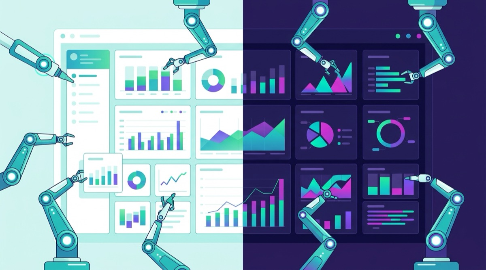

Grafana Labs activó la primera fase de lo que llama su **mayor refresco visual desde Grafana 7**, integrado en **Grafana 13.3** y disponible en **public preview** tanto en Grafana Cloud como en despliegues self-managed. No es un rediseño desde cero: es algo menos glamoroso pero más útil — pagar la deuda de diseño acumulada tras años de features a toda velocidad.

## Qué cambia en la interfaz

- **Temas claro y oscuro nuevos por defecto**, con paletas rediseñadas enfocadas en mejorar la accesibilidad.
- **Menos variantes de componentes**: las tarjetas, panels y drawers se estandarizan, para que un patrón de interacción aprendido en un lado funcione en todos lados.
- **Tipografía, bordes, sombras y capas visuales** ajustados para una jerarquía más clara: menos elementos compitiendo por tu atención y más señal cuando estás en medio de un incidente a las 3 AM.
- El equipo está revisando los **primitivos de diseño** de fondo, no solo repintando la superficie.

## Por qué ahora: la era agéntica

El motivo más interesante no es estético. El desarrollo del **Grafana Assistant** y el Assistant Workspace introdujeron nuevos patrones de interacción para flujos con IA, y la apuesta de Grafana es que la interfaz gráfica **convivirá con interacciones de terminal y chat agéntico**. Si el agente se hace cargo de la mitad del trabajo, lo que queda en pantalla tiene que ser clarísimo y predecible: entender la información, reconocer cambios importantes y saltar entre flujos sin reaprender convenciones.

Con esa lógica, la consistencia visual deja de ser cosmética y pasa a ser parte de la resiliencia operativa. El despliegue va **por fases**, con espacio para feedback de usuarios y contribuidores antes del siguiente paso — una movida prudente para un ecosistema de plugins tan grande como el de Grafana.

**Fuentes:** [InfoQ](https://www.infoq.com/news/2026/11/grfana-ui-refresh/) · [Grafana](https://grafana.com/blog/)
