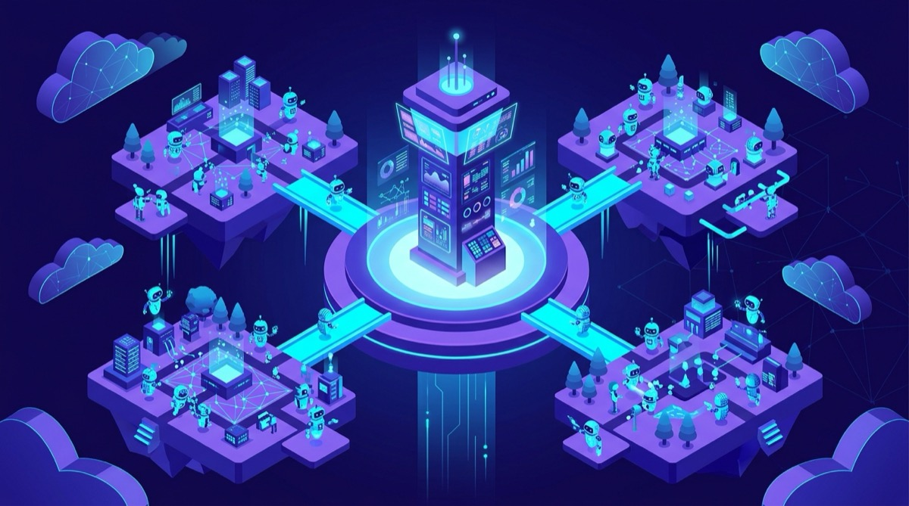

Anunciado en Ignite 2026 pero recién ahora siendo digerido en toda su dimensión, **Agent 365** es la apuesta de Microsoft por un **control plane común para gestionar, gobernar, asegurar y medir el valor de los agentes de IA** — los suyos y los de todos los demás. Sí: Amazon Bedrock, Google Vertex AI, Salesforce Agentforce, Databricks, Snowflake, Anthropic, OpenAI, Oracle, SAP, ServiceNow y UiPath aparecen en la lista de plataformas soportadas.

## La empresa real es heterogénea

El análisis de InfoWorld le pone el dedo en la llaga: las empresas no viven en los mundos de un solo vendor que pintan los keynotes. Compras heredan sistemas, cada equipo elige sus herramientas y el resultado es multicloud por definición. Con agentes encima: ventas usa agentes de Salesforce, desarrollo usa Copilot y Claude Code, datos construye sobre Databricks o Snowflake. Ninguna empresa seria va a limitarse a una sola plataforma de IA para facilitar la vida de las herramientas de gestión del vendor.

La movida estratégica es que Microsoft — histórico constructor de ecosistemas propietarios — esté eligiendo **gobernar la empresa como existe, no como quisiera que existiera**. Es un refresh pragmático que reconoce el multicloud como modelo operativo estándar.

## Qué controla exactamente

- **Inventario y identidad**: descubrimiento de agentes (incluida detección local de agentes de terceros), identidad vía Entra Agent ID.
- **Riesgo y políticas**: evaluación de riesgo por agente y controles centralizados sobre qué puede hacer cada uno.
- **Monitoreo de actividad**: visibilidad de qué hacen los agentes, en qué plataforma correan.
- **Costo y valor**: analítica de cuánto cuesta y cuánto devuelve cada agente — más allá del dashboard de factura.

## El contexto de Ignite del que viene

Agent 365 es la capa de gestión del paquete agéntico que Microsoft presentó en Ignite: Copilot como "sistema operativo del trabajo", Agent Grid aplicando políticas a interacciones agente-modelo-herramienta, y el Azure SRE Agent que ya salta la cerca hacia AWS y Google Cloud. La analítica coincide en que el nivel de integración variará por plataforma — como siempre pasa en escenarios cross-vendor — pero la dirección es la que importa.

Para equipos de plataforma y arquitectura, este anuncio define una categoría nueva que conviene vigilar: si la gobernanza de agentes se va a estandarizar, el que controle el control plane controla la relación con todos los modelos. Y Microsoft acaba de plantar su bandera en terreno ajeno.

**Fuentes:** [InfoWorld](https://www.infoworld.com/article/4253806/microsofts-agent-365-tackles-multicloud-ai-governance.html) · [Microsoft Ignite 2026 Book of News](https://news.microsoft.com/events/ignite/2026/book-of-news/) · [InfoQ](https://www.infoq.com/news/2026/11/microsoft-ignite-2026-recap/)
